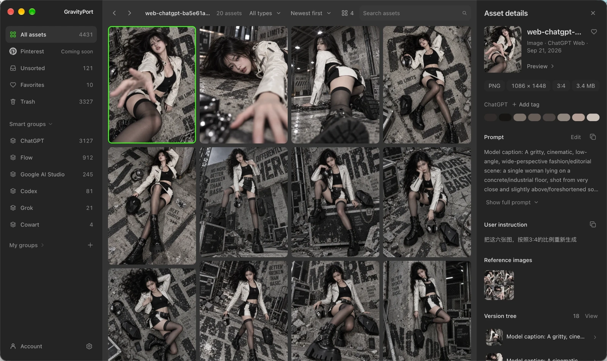

# GravityPort

English | [简体中文](README.zh-CN.md)

[](https://github.com/fengseekling-coder/gravityport/actions/workflows/ci.yml)
[](LICENSE)
[](#downloads)

> **Local visual memory for AI creation.**
> 把 AI 生成的每一张图，连同 Prompt、来源和版本，留在自己的电脑上。

GravityPort is a local-first library for AI-generated images, videos, Prompts, provenance, and version history. It keeps creative output from Codex, Grok Build CLI, Cowart, and an optional Web Capture extension for ChatGPT, Gemini, Flow, and Google AI Studio in one library on your own computer.



**Local-first · Prompt & provenance · Version history · No GravityPort cloud account**

[Downloads](#downloads) · [中文使用指南](docs/guide.zh-CN.md) · [Privacy](PRIVACY.md) · [Documentation](#documentation)

## Downloads

Get GravityPort from the [official download page](https://gravityport.azhuilab.com/#download). It always lists the current packages with their sizes and SHA-256 values.

- **GravityPort Desktop for macOS** (Apple Silicon): a DMG. Drag `GravityPort.app` into Applications.
- **GravityPort Desktop for Windows 10/11** (x64): a portable ZIP. Extract it and run `GravityPort.exe`.
- **GravityPort Web Capture** (Chrome / Chromium, optional): a ZIP; load it after the desktop app is running and the two pair automatically. See the [install guide](https://gravityport.azhuilab.com/guide/).

Installed desktop apps check for updates themselves in **Settings → About**. The [release manifest](https://gravityport.azhuilab.com/releases/gravityport/latest.json) is the machine-readable source for the newest version.

## Why GravityPort

An image alone rarely tells you how to use it again. The Prompt may be in another conversation, the source tool may be forgotten, and the version you actually want may be buried among near-duplicates.

GravityPort reconnects each asset with the context that makes it reusable: its available Prompt, generation source, provenance, and version history. The library remains under your control on your machine.

## What you can do

### Keep the context with the asset

Archive generated images and videos together with their available Prompt, source, model or tool context, timestamps, and provenance. GravityPort records when a Prompt is unavailable instead of inventing one.

### Organize by drag and drop

Browse and search one gallery with adjustable column counts, marquee selection, and multi-select. Drag cards onto a sidebar group to file them, onto another card to build or join a stack, inside a stack to reorder it, or out of the window to hand the files to another app. A stack built or joined by drag can be undone for a few seconds.

### Iterate on the version tree

The Inspector shows each asset's version tree, with generations from a ChatGPT conversation grouped by conversation round so you can see how the image evolved turn by turn. Any two versions in a family can be compared side by side.

### Let AI agents search your library

The built-in MCP server lets Claude, Codex, and other MCP clients list, search, and record assets, Prompts, versions, and generation history in the same local library. `asset_search` combines text and a time range. The desktop app ships the server: copy a ready-made config for Claude Desktop, Claude Code, or Codex from Settings → Connect, with no Node.js or source checkout needed. From source, run `npm run mcp`. See [MCP 与接口](docs/guide.zh-CN.md#mcp-与接口) for setup and the tool list.

### Recover deleted work and back up the library

Removed assets move to Trash, where they are kept for 90 days with a per-asset countdown. Right after a deletion an undo button offers to reverse it; Trash has its own menu for restoring, deleting permanently, and emptying. For whole-library safety, the `gravityport backup`, `backup-verify`, and `restore` commands create and check verified point-in-time backups.

Settings → Feedback sends bug reports and ideas, optionally with a redacted diagnostic log that you can read in full before sending. A Pinterest connection for browsing your own boards is built but stays unavailable until Pinterest approves production API access.

## Fits into your workflow

| You create in | GravityPort keeps |
| --- | --- |
| **Codex Desktop** | Generated images and the matching local generation context when available |
| **ChatGPT, Gemini, Flow, or Google AI Studio in Chrome** | Optional visible web-generated images and conservative page-scoped context through the local extension |
| **ChatGPT desktop app** | Images from desktop chats, picked up by the same extension (auto capture on) through your browser's ChatGPT session |
| **Grok Build CLI** | Images and videos from local sessions, with matched tool context when available |
| **Cowart** | Approved canvas snapshots archived from Cowart into the library |

Whatever the source, everything lands in the same local gallery with groups, stacks, Trash with undo, and the version tree. GravityPort does not generate media or replace any of these tools.

## Platform status

| Target | Status |
| --- | --- |
| macOS arm64 | Main desktop target. DMG for first install, in-app updates afterwards. |
| Windows 10/11 x64 | Portable ZIP, in-app updates afterwards. |

## Run from source

For development, or to run GravityPort as a local web app without the desktop shell. Requires Node.js 22 or newer and npm.

```bash
git clone https://github.com/fengseekling-coder/gravityport.git
cd gravityport
npm ci      # installs dependencies and builds the UI
npm start   # starts the local service on 127.0.0.1:43517
```

Open <http://127.0.0.1:43517>. Run `npm test` to check your checkout. Codex Desktop and the Cowart plugin are optional integrations; the [Chinese guide](docs/guide.zh-CN.md) covers their setup and the complete source-by-source behavior.

The Electron desktop shell uses the same Web UI and local runtime:

```bash
npm run desktop:start

# macOS arm64 DMG
npm run desktop:make

# Windows 10/11 x64 package directory
npm run desktop:package:windows
```

Desktop packaging needs Node.js 22.x; the repository pins `22.23.1` in `.nvmrc` and `.node-version`, and packaging commands stop with a clear message on any other major. Release tracks, signing, notarization, and manifest publishing are described in the [release guide](docs/releasing.md).

## Local by design

- GravityPort is a local Web UI bound to loopback; it is not a cloud service and must not be exposed through a public port or reverse proxy.
- It reads only its configured Codex, Grok, and approved Cowart locations. It does not scan Downloads, Desktop, or arbitrary image folders.
- Web Capture is optional. Packaged Desktop provisions its local ingest Token and fixed approved extension origins automatically; a standalone `npm start` runtime keeps capture disabled until those values are configured explicitly. The extension sends captured image bytes and page provenance only to the configured local GravityPort address. ChatGPT retains message-scoped context when available; Gemini, Flow, and Google AI Studio retain only narrowly associated visible user Prompt text when it can be safely matched and mark it unverified. With auto capture on, the extension also captures images from conversations you just used in the ChatGPT desktop app by opening them briefly in a minimized browser window; see [PRIVACY.md](PRIVACY.md#chatgpt-desktop-app-conversations).
- Eligible reference images are stored as private, content-hash-deduplicated generation-record attachments, not ordinary gallery assets.
- The desktop app ships and downloads no AI model. GravityPort adds no remote sync or automatic upload of your library.
- Packaged desktop builds send minimal anonymous install/activity metadata through a separate bodyless request to the same first-party release endpoint used for update metadata. This contains only a random installation ID, version, platform, architecture, and first-launch/daily-active event, and never includes assets, Prompts, or local paths. See [PRIVACY.md](PRIVACY.md), which also explains how to turn it off.

See [PRIVACY.md](PRIVACY.md) for the full data boundary and [SECURITY.md](SECURITY.md) for private vulnerability reporting.

## Documentation

User guides:

- [中文使用指南](docs/guide.zh-CN.md) (中文): setup, sources, local library, search, versions, MCP, and maintenance.
- [Context menu](docs/context-menu.md) (中文): sidebar, card, and empty-grid actions.
- [Web Capture extension guide](extensions/chatgpt-web-capture/README.md) (中文): local setup, permissions, capture behavior, and limitations.

Running and developing GravityPort:

- [Operations guide](docs/operations.md) (English): operating modes, migration, backup, verification, bridge health, and recovery boundaries.
- [Release guide](docs/releasing.md) (English): distribution tracks, signing, update manifests, release notes, and optional pack publishing.
- [Architecture](ARCHITECTURE.md) (中文): current runtime, storage, and integration layout.
- [Design system](DESIGN.md) (中文): colors, type, spacing, components, and copy rules for the desktop interface.
- [Contributing guide](CONTRIBUTING.md): development workflow, checks, and privacy requirements.

Policies and history:

- [Privacy policy](PRIVACY.md): data sources, local storage, extension permissions, and network boundaries.
- [Security policy](SECURITY.md): supported versions and private vulnerability reporting.
- [Support guide](SUPPORT.md): questions, bug reports, and feature requests.
- [Changelog](CHANGELOG.md) and [Web Capture changelog](extensions/chatgpt-web-capture/CHANGELOG.md): user-visible changes and release status.
- [Third-party notices](THIRD_PARTY_NOTICES.md): upstream projects and models that GravityPort builds on or redistributes.

## License

GravityPort is source-available under the [PolyForm Noncommercial License 1.0.0](LICENSE).

- Noncommercial personal, educational, research, hobby, modification, and distribution uses are permitted under the license terms.
- Commercial use, paid services, client delivery, commercial platform integration, or other anticipated commercial applications require a separate written license from the copyright holder. See [COMMERCIAL-LICENSE.md](COMMERCIAL-LICENSE.md).
- Redistributions must preserve the license terms and required copyright notice.

GravityPort is source-available software, not OSI-approved open-source software.

Third-party attribution is documented separately in [THIRD_PARTY_NOTICES.md](THIRD_PARTY_NOTICES.md) and does not change GravityPort's own license terms.
